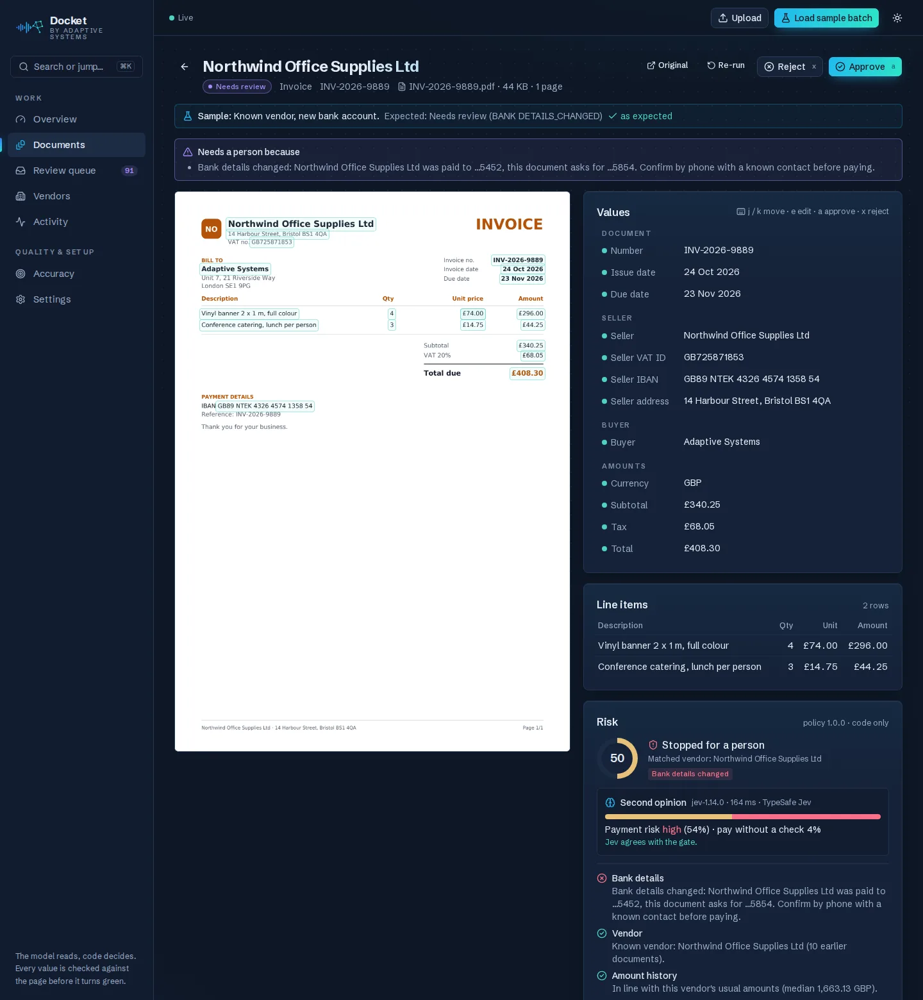
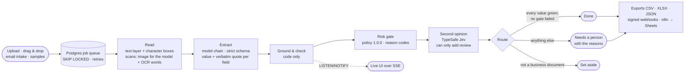
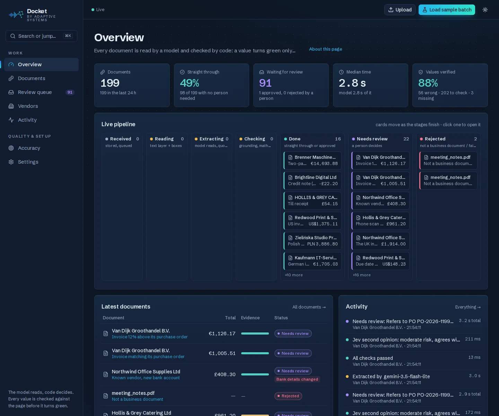
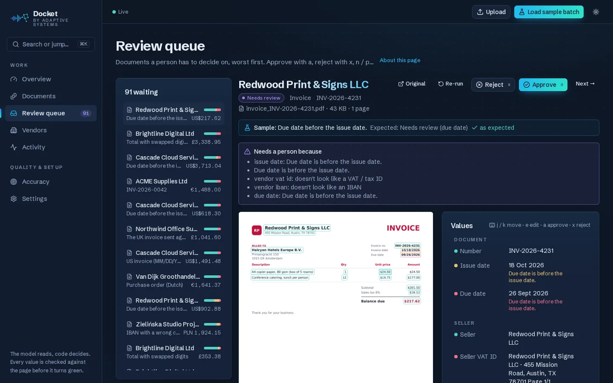
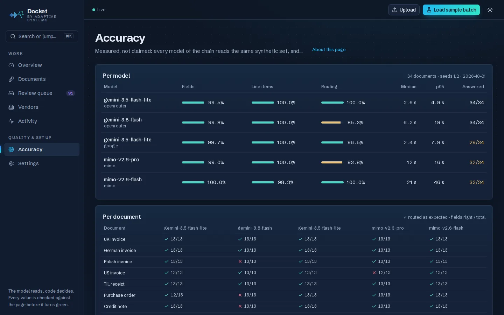

# Docket — invoice and document intake that shows its working

> **Case study.** Docket turns the documents a business receives (invoices, receipts, purchase
> orders, credit notes) into checked, structured data. A model **reads** each document; deterministic
> code **decides**: every value must point at the exact place on the page it came from, arithmetic, IBAN,
> VAT and dates are verified in code, and a risk gate stops bank-detail swaps, look-alike suppliers,
> duplicates and purchase-order mismatches before anything gets paid. A person reviews only what needs
> it; clean data goes out to a spreadsheet, a signed webhook or an accounting system.
> Every number on this page was measured on the running system. The source code is private; this
> repository holds the case study.

  <b>Live:</b> <a href="https://adaptivesystems.dev/one-pager">one-pager</a> ·
  <a href="https://adaptivesystems.dev/docket/try">try your invoice</a> ·
  <a href="https://adaptivesystems.dev/docket">product page with live numbers</a> ·
  <a href="https://adaptivesystems.dev/live#docket">live activity</a> ·
  <a href="https://status.adaptivesystems.dev/status/stack">status page</a> ·
  <a href="https://adaptivesystems.dev/">adaptivesystems.dev</a> 
  <i>Sibling of the <a href="https://github.com/adaptivesystemsdev/ai-command-center">Front Desk AI stack</a> ·
  same server, separate stack and database · the same engine runs
  <a href="https://github.com/adaptivesystemsdev/dossier-applicant-verification">Dossier</a> (applicant document verification).</i>

  
  
  
  

  

---

## Problem

Accounts-payable teams still retype invoices, or trust an extraction tool that returns confident values
nobody can check. The expensive failures aren't typos: a known supplier's invoice that quietly asks to be
paid into a **new bank account**, a supplier name that differs from the real one by a single Cyrillic letter,
the same invoice sent twice, an invoice 12 % above its purchase order. Commercial intake tools solve this
from ~$500 a month to five figures a year. Docket does the same core, self-hosted, and makes every value
explainable.

## Approach: the model reads, code decides

**1. Grounded or flagged.** For every field the model returns the value **and the exact words it read**.
Code finds those words in the page's text layer, down to the character boxes, and draws the box on the
page. Then it checks the value is actually one of code's own readings of that quote: a strict number
tokeniser (thousands separators per locale, signs that must touch their digits, credit-note parentheses)
re-reads every amount; a date, IBAN or VAT number must have the right shape for what it claims to be.
Found on the page but the wrong kind of thing (an amount placed in the VAT field) is red, not green.
**A value without a location on the page is never green.**

**2. Checks in code, never by the model.** Line items × quantity add up to the subtotal, subtotal + tax =
total (with a tolerance and a "digits swapped?" hint), IBAN mod-97, VAT number format per country, due date
after issue date, ISO currency, duplicates beyond the invoice number. Each check explains itself in plain
English and lights up the fields it concerns.

**3. A risk gate before money moves.** A pure, versioned function (modelled on the deterministic policy
gate of our lead-scoring stack): named gates with pass / warn / fail, a 0–100 risk score from a documented
formula, machine-readable reason codes, per-workspace policy.

| Reason code | What it catches |
|---|---|
| `BANK_DETAILS_CHANGED` | a known supplier asks to be paid into an account it has never been paid to: confirm by phone first |
| `IBAN_FIRST_TIME` | a first-time account is held for one approval; only a person or an imported vendor list can approve an account |
| `LOOKALIKE_VENDOR` · `MIXED_SCRIPT_NAME` | "Northwind" vs "Nоrthwind" (Cyrillic о): confusable letters folded, near-matches with their own IBAN stopped |
| `DUPLICATE` | same supplier, amount and date window or the same content, even under a new invoice number |
| `PO_MISMATCH` · `PO_NOT_FOUND` · `PO_MATCH` | two-way purchase-order match with price tolerance; an unknown or unapproved PO fails |
| `AMOUNT_OUTLIER` · `TAX_RATE_UNUSUAL` | far above the supplier's usual amounts; a VAT rate that doesn't exist in the supplier's country |
| `BANK_DETAILS_UNREADABLE` | an IBAN that half-reads is never "probably fine" |
| `SENDER_LOOKALIKE` · `SENDER_NEW_DOMAIN` · `SENDER_FREEMAIL` · `SENDER_UNVERIFIED` · `SENDER_UNSIGNED` | emailed invoices: a look-alike of the supplier's domain (northw1nd.co.uk, or the same name under another suffix) is stopped; a new domain, a personal address, a failing or missing DKIM signature are flagged |

**Invoices by email.** Each workspace has a private address (`docket-<workspace>.<token>@in.<domain>`), served by our
own Postfix: the business forwards its invoices mailbox to it (a Gmail filter, an Outlook rule, the domain's
forwarding) or gives it to suppliers. Every PDF / image attachment becomes a document with who sent it; other
files are listed and left out, auto-replies and bounces are ignored, the same Message-ID is read once. The sender
is checked against business email compromise: DKIM is verified per signature (the From domain must have signed,
From included), registrable domains come from the Public Suffix List, and a supplier's domains are learned only
from mail that domain signed or from the imported vendor list, so a forged From line never teaches Docket anything.

**4. A second opinion that can only be more careful.** Every finished document gets an independent risk
read from [TypeSafe Jev](https://typesafe.ai). It sees **only the check results**, never names, amounts or
IBANs. A strong "high risk" can send a document to a person; it can never pass a document the gate stopped.
Fail-open with a 2.5 s deadline, so an outage never blocks the pipeline.

**5. Graceful degradation.** A chain of vision models, each with its own deadline. If every model fails, the
document still gets a row, the checks that need no model, and a person, never an error and never a silent drop.

## The app

  

- **Overview:** live counters and a pipeline board. Cards glide Received → Reading → Extracting →
  Checking → Done / Needs review / Rejected as server events arrive (Postgres LISTEN/NOTIFY → SSE). Below it: documents per day (14 days, by where each document is now), a status donut,
  an "every value read" evidence bar (verified / to check / wrong / missing) and the risk flags as bars.
- **Document view:** the page on the left with a box around every value read from it, the values on the
  right coloured by evidence (green = found on the page and passed every check, amber = needs a look,
  red = wrong or unreadable). Hover a value and its source glows. To correct one, click the right words on
  the page. Then the risk panel, the checks, and per-stage timings with the model that read it.
- **Review queue:** worst first, keyboard-first (j / k, e edit, a approve, x reject, n / p), every
  exception explains itself.

  

- **Vendors:** the vendor master with **approved** vs merely **seen** bank accounts; CSV import of an
  accounting export approves accounts in bulk.
- **Accuracy:** the latest published evaluation, per model and per document.
- **Settings** (every option explained in place): team notifications, signed webhook (secret rotation, test
  event, delivery log with retry), export history, the risk policy (incl. tax-rate strictness and a US sales-tax
  ceiling), Reading (OCR of scans on / off), retention, email intake, the public try-it demo.
- **⌘K** jumps to any page, document or action; light and dark themes; works on a phone.

## Outputs

- **Export verified batch:** everything that went straight through or was approved since the last export,
  as CSV (one row per document), XLSX (Documents + Line items sheets, numbers as numbers) or JSON, with a
  person's corrections applied. Text cells that would start a spreadsheet formula (`= + - @`) are
  neutralised.
- **Signed webhooks:** `document.done`, `document.needs_review`, `document.approved`, `document.rejected`;
  Stripe-style `t=…,v1=HMAC-SHA256` signature, retries with backoff on network errors / 408 / 429 / 5xx,
  every attempt in a delivery log.
- **Team notifications:** Slack (a channel of the client's choice, via its own incoming webhook), Telegram or
  email when a document needs a person (optionally also approved / rejected / straight-through ones): vendor,
  total, the reasons in plain English, serious risk flags, a link to the document. They ride the same delivery
  queue as the webhook (retries, delivery log); text from documents is escaped so it can't @-mention a channel;
  the file never leaves Docket. Email goes out from our own mail server on its own isolated network, DKIM-signed,
  and the mail server lets Docket send only as its own address.
- **n8n → Google Sheets:** a ready workflow appends one row per document. It runs live into a shared sheet.
  The same webhook feeds Zapier, Make, Xero / QuickBooks flows or any ERP.

## Architecture

| Part | Technology | Role |
|---|---|---|
| api | Python 3.12 · FastAPI · Pydantic v2 · SQLAlchemy 2 (async) · Alembic | upload, documents, review, exports, settings, SSE |
| worker | same codebase, 3 loops | job queue (`FOR UPDATE SKIP LOCKED`, leases, retries, dead-letter), pipeline, webhook delivery |
| reading | pypdfium2 (permissive licence) | text layer with per-character boxes, page rendering; scans detected and read visually |
| OCR | RapidOCR 3.10 · PaddleOCR PP-OCRv6 small on ONNX Runtime (Apache-2.0, CPU) | scans and phone photos: words with boxes, EXIF + orientation + deskew; chosen by measurement (97 % of digit words exact on harsh photos, ~1.5 s / page) |
| extraction | pydantic-ai, strict structured output | OpenRouter Gemini 3.5 Flash-Lite → GPT-6 Luna → Ling-3.0 Flash VL → Google AI Studio → Xiaomi MiMo, per-model deadlines |
| rules | pure Python modules | grounding, number readings, identifier shapes, arithmetic, IBAN / VAT / dates, duplicates, risk gate |
| second opinion | TypeSafe Jev 1.14 | independent payment-risk read on check facts only |
| data | PostgreSQL 16 + `pg_trgm` | documents, pages, jobs, extractions, reviews, vendors, POs, deliveries, append-only events |
| web | Next.js 16 · TypeScript · Tailwind 4 · shadcn/ui · TanStack Query · Motion | the app above; server-rendered page images instead of a PDF.js worker (same look for PDFs and scans, a tighter CSP) |
| edge | nginx · Let's Encrypt · Uptime Kuma | TLS, auth, CSP, rate limits, monitoring |

Docker Compose, own network and database, pinned images and locked dependencies. The public website reads
aggregate numbers and a fixed-template activity feed from a loopback-only endpoint that never carries supplier
names, amounts, IBANs, file names or ids (tested).

## Measured

| Metric | Value | Notes |
|---|---|---|
| Field accuracy | **99.2 %** | published eval (what the app's Accuracy page and the company site show), 50 synthetic documents from 8 countries (invoices, receipts, POs, credit notes, multi-page, scans, fraud cases), production model, 2026-11-01 |
| Line items | **99.0 %** | same run |
| Routing (done vs needs a person, as expected) | **98 %** | same run, risk gate included |
| Time per document | **median 3.0 s** (eval) · **≈ 2.9 s** median live | read ≈ 10 ms, checks ≈ 12 ms, Jev ≈ 170–250 ms, the rest is the model |
| Scans and phone photos | **100 %** fields · **100 %** line items · **93.8 %** routing | phone scan, photo at an angle in bad light, photo stored sideways, image-only scanned PDF; production model, 2026-11-01; the one miss went to a person (OCR unsure of a total) |
| Live sample batches | **20 / 20** documents read, every scan straight through with all values boxed |
| Europe + US, 25 scenarios × 3 batches (a local development run, not the published eval) | **99.5 %** fields · **99.0 %** line items · **97.3 %** routing | UK / German / Polish / Dutch / French / Italian / Spanish / US invoices, a discount, two VAT rates on one invoice, USD to an EU buyer, a US vendor's new ACH account; 2026-11-01 | bank change, look-alike, duplicate, PO match / mismatch, swapped digits, due date before issue date, not a business document |
| Automated tests | **310** (Docket + Dossier engine) | the model replaced by a scripted one; property-based tests for the IBAN / VAT / number validators; `mypy --strict`, ruff |

**Europe and the US.** A bank account is an IBAN or a US ACH routing + account number (the routing number's ABA
checksum is checked in code); both go through the same bank gate, so a US supplier who "changed banks" is stopped
like a European one with a new IBAN. Tax is checked per country: EU VAT rate by rate (also two rates on one
invoice), US sales tax within the state + local range. Discounts below the items are part of the arithmetic.

**Scans: two readers that never see each other.** A photo of an invoice goes to the model as an image AND through
OCR; the model is never shown the OCR text. A value turns green only when the model's quote is found among the
OCR words, digit for digit, so a scan gets the same boxes on the page as a PDF. OCR's own confidence score was
measured too (4,190 digit words): it barely separates right from wrong readings, so the agreement of two
independent readers is the evidence, not the score.

Five models were compared on the same set before choosing the chain. A bigger, newer model was **slower and
routed worse** (85 %) than the cheap Flash-Lite. More model doesn't buy correctness; deterministic checks do.

  

Test documents are generated by our own script (layouts, languages, currencies, VAT rates, scans with noise
and rotation) with the ground truth known. No real client documents are used for development or evaluation.

## Security

- **Approval comes from a person, never from a document.** Bank accounts learned from documents that went
  through by themselves are only "seen"; the first payment to any account needs a human or an imported
  vendor list (standard accounts-payable practice: verify bank details out of band).
- **Fail closed on ambiguity.** A sign detached from its digits, a quote with two amounts, a half-readable IBAN:
  no reading, the value stays red.
- **Outbound webhooks can't be turned inward.** Every resolved address must be public (incl. NAT64 / mapped /
  6to4 forms), the connection is pinned to the checked IP with the certificate verified for the name, no
  redirects, a total deadline well below the worker lease.
- **Email you can't fake your way through.** The intake endpoint is reachable only from the host's mail pipe
  (a shared secret, refused when it came through the web server); an address can be rotated at once; a message
  with two From headers has no trusted sender at all (two parsers could disagree on which one counts).
- **Nothing silently dropped.** Every input gets a row and a final state; failed jobs are retried, then
  visible.
- **Private by default.** The app is behind authentication, ports are loopback-only, files never appear in logs.
  Six security-review rounds on the number parser and four on the risk gate before release. Each finding has
  a regression test.

## What I learned

The long version, with dates, numbers and what didn't work: [ENGINEERING_NOTES.md](ENGINEERING_NOTES.md).

- **Grounding proves presence, not kind.** The model put an amount into the VAT field; the text *was* on the
  page, so it showed green. Shape checks per identifier now run after grounding.
- **Evals find your bugs, not the model's.** The first evaluation routed 43–64 % correctly. Almost every miss was
  in our own code: currency symbols glued to amounts, glyphs that split one printed line into two, the literal
  word "null". Fixed in code, routing went to 100 %.
- **The first sender of a supplier name must not define the truth.** An early version trusted the first IBAN it
  saw for a supplier, so an attacker who got there first was approved forever. Now trust comes only from a person.
- **"Respond immediately" lies.** An n8n webhook answering before writing the row made failed rows look
  delivered. The receiver now answers after the last step, so a sheet error is a retried delivery.
- **Cheap beats big for structured reading.** The smallest Flash model was the most accurate and the fastest
  for this task.

---

**Also from us:** [Dossier](https://github.com/adaptivesystemsdev/dossier-applicant-verification) (applicant document verification) ·
[Front Desk](https://github.com/adaptivesystemsdev/ai-command-center) (conversations) · all three on
[one page](https://adaptivesystems.dev/one-pager). Need something else built to the same standard?
[Hire us for a custom build](https://adaptivesystems.dev/contact?topic=custom).

*Portfolio case study. The live app is private; a walkthrough is available on request via
[Upwork](https://www.upwork.com/freelancers/~01e6b54c0e8f04bcaa) or [adaptivesystems.dev](https://adaptivesystems.dev/contact).*
